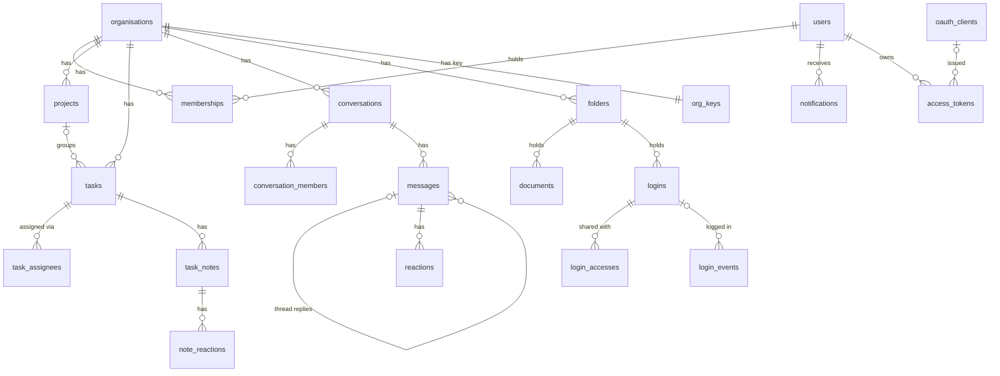
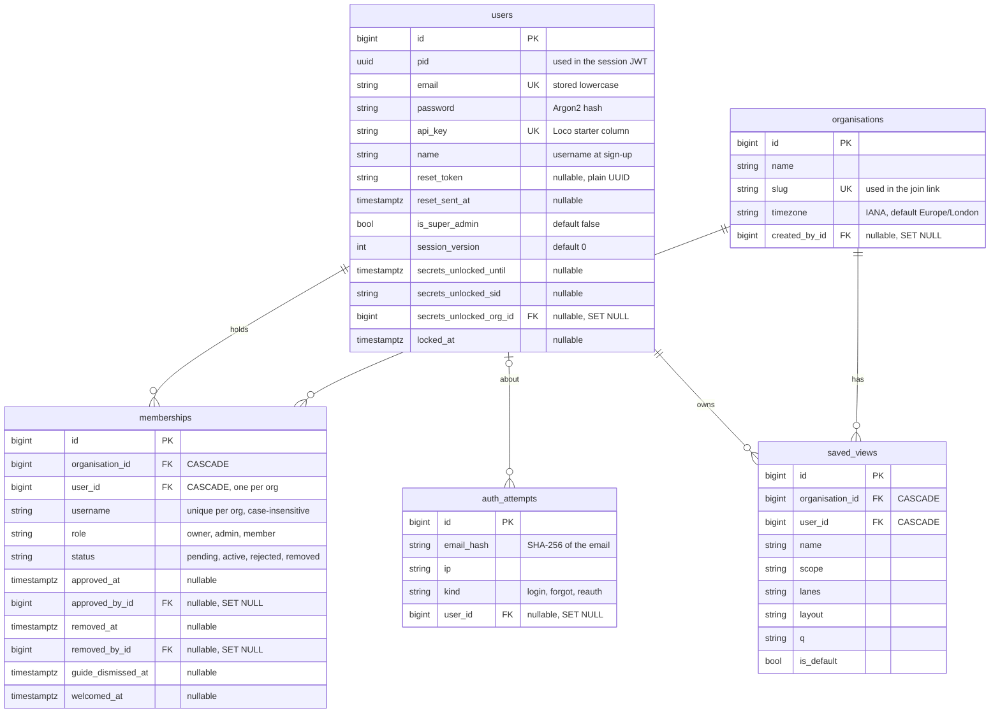
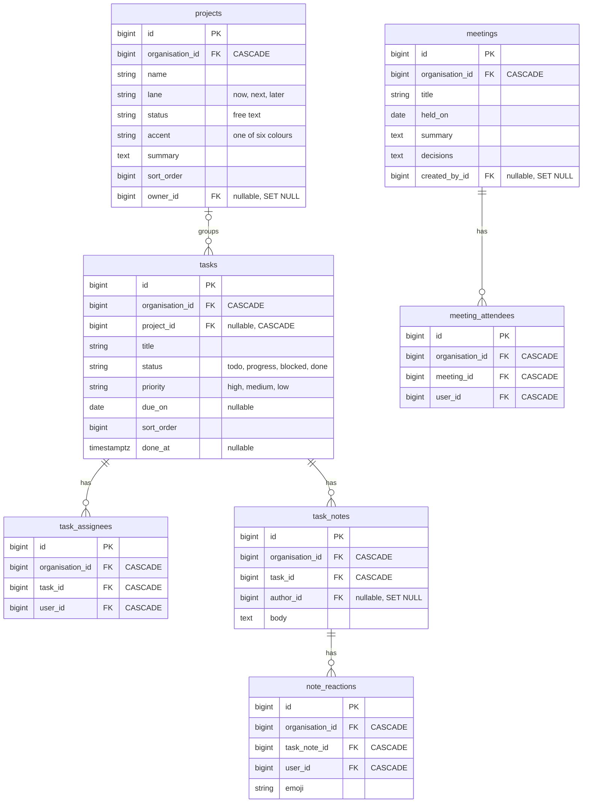
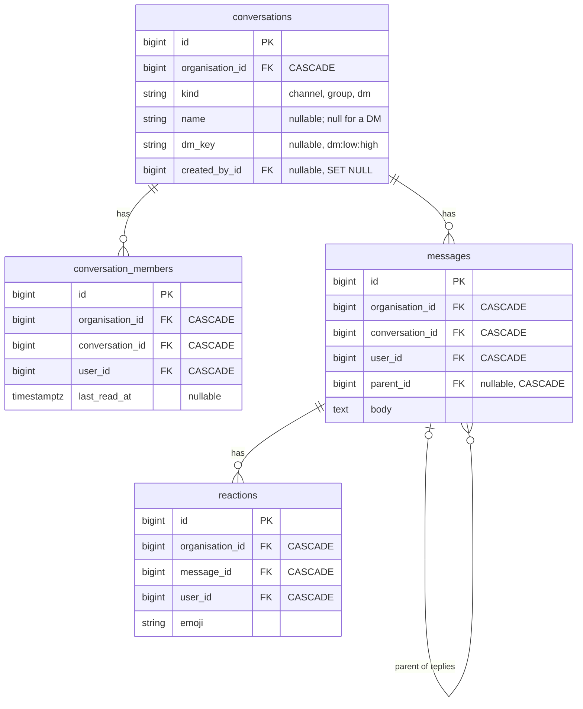
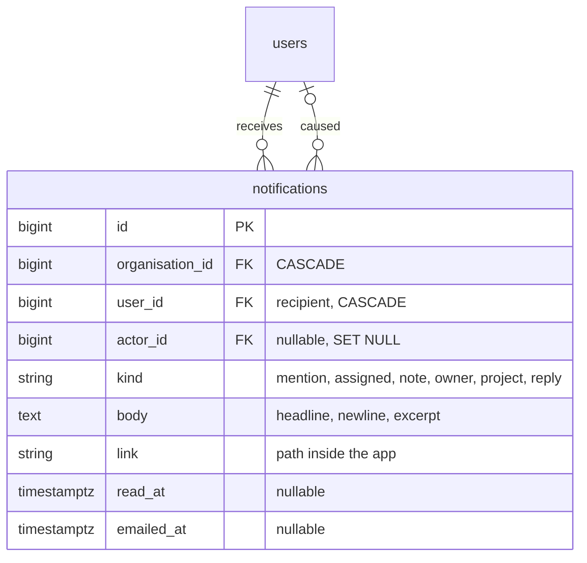
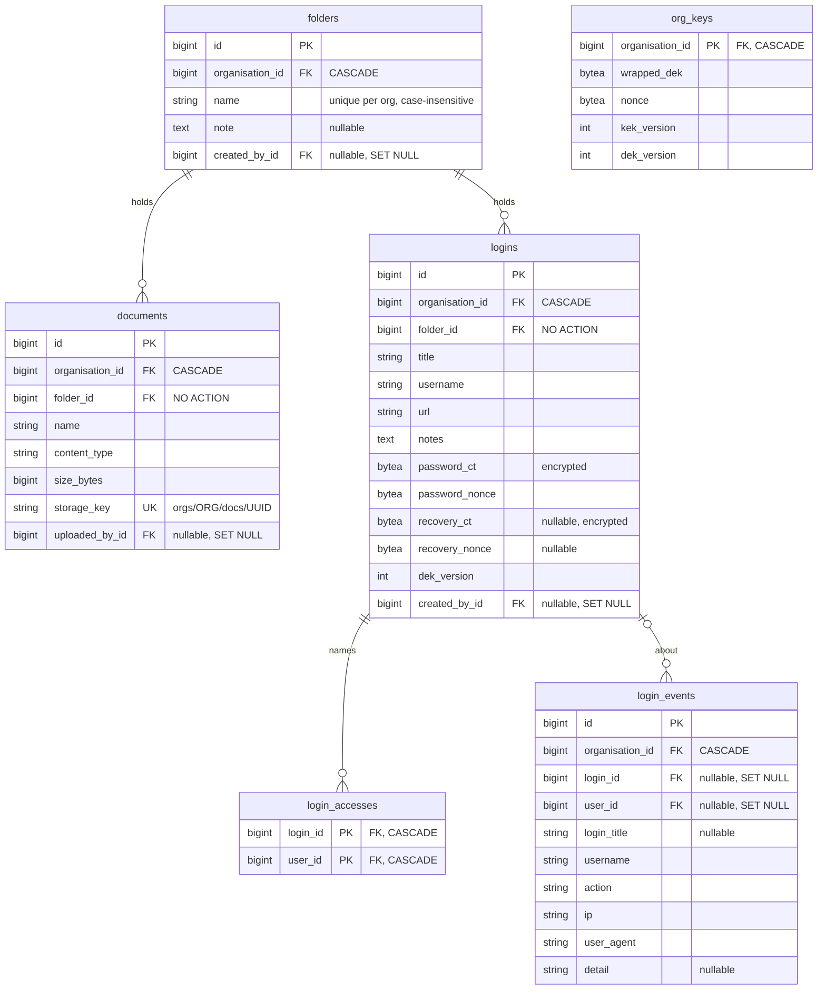
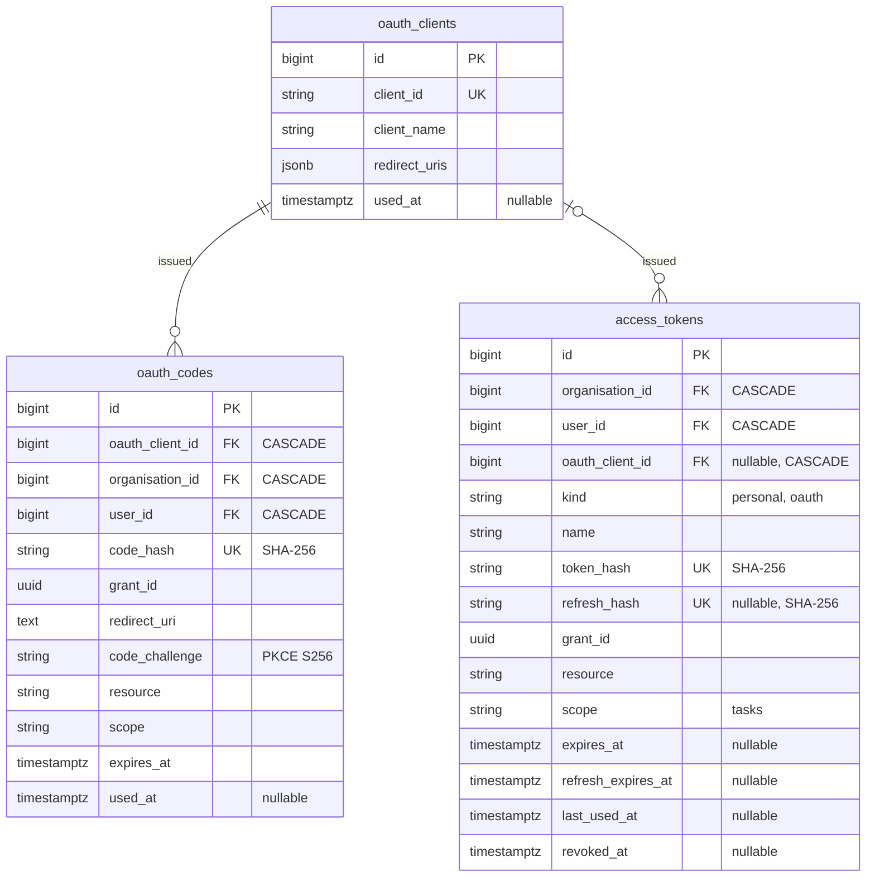

# Data model (ERD)

Last checked against the code: 19 October 2026 (main at `4bc41ea`).

Sources: the generated entities in `src/models/_entities/*.rs` and the
migrations in `migration/src/`. Indexes and `ON DELETE` rules come from the
migrations. Every table also has `created_at` and `updated_at`; the diagrams
leave them out.

## Overview

The core tables and how they connect. Columns are in the per-area diagrams
below. Most tables also carry `organisation_id`; those lines are drawn only
where they help.

Not drawn: `meetings`, `meeting_attendees`, `saved_views`, `oauth_codes` and
`auth_attempts`. They are in the area diagrams.

## Tenancy rules

- An organisation is the tenant. Every table holds `organisation_id`
  (not null, `ON DELETE CASCADE`) except four: `users`, `oauth_clients`,
  `auth_attempts` and `login_accesses`. `org_keys` uses `organisation_id` as
  its primary key.
- Tenant scoping is explicit. Each tenant model implements Loco's
  `TenantEntity` (for example `src/models/tasks.rs`, at the end of the file).
  Queries add `.in_tenant(org_id)`, which is just a `WHERE organisation_id = ?`.
  New rows get the tenant with `.set_tenant(org_id)`. Loco's own docs say a
  query without `in_tenant` stays unscoped, so every query must add it.
- The tenant id always comes from `CurrentMember` (`member.org.id`), never
  from the request. See `src/extractors/current_member.rs:1`.
- Lookups by id use `find_in_org` style helpers that add `in_tenant`. An id
  from another organisation is "not found".
- Deleting an organisation cascades to everything it owns. There is no
  route that deletes an organisation today.

## People and tenancy

Unique indexes:

- `users.email`, `users.api_key`, `organisations.slug`.
- `idx-memberships-org-user` on `memberships (organisation_id, user_id)`: one
  membership per user per organisation. A user can belong to several.
- `idx-memberships-org-username` on `memberships (organisation_id, lower(username))`.

Other indexes: `idx-memberships-user` on `memberships (user_id)`, for finding
a user's memberships.

Generated entities (`src/models/_entities/`) are left as `cargo loco db
entities` writes them, so a few attributes there do not match the schema:

- In `users.rs`, the `Organisations` relation is a `belongs_to` through
  `secrets_unlocked_org_id`. It means "the org of the current logins
  unlock", not "the orgs this user created". Nothing in the code uses it.
- The `unique` and `unique_key` attributes on `memberships.organisation_id`
  and `memberships.user_id` come from codegen reading the indexes. The real
  rules are the unique indexes listed above.

Rules:

- Roles are `owner`, `admin` and `member` (`src/models/memberships.rs:17`).
  Owners and admins "manage": approve, decline, remove, set the time zone.
  Only an owner changes roles, and the owner's own role cannot change.
- Statuses are `pending`, `active`, `rejected` and `removed`
  (`src/models/memberships.rs:23`). The UI calls `rejected` "declined".
  Only `active` members get past `CurrentMember`.
- Removing a member never deletes the row. It sets `status = removed`,
  `removed_at` and `removed_by_id`.
- Asking to join again sends a `removed` or `rejected` row back to `pending`,
  the same row, with its role, `approved_*` and `removed_*` kept as history.
- `approved_at` is the time of the last decision, approve or decline, and
  `approved_by_id` who made it. Approval also clears `removed_at` and
  `removed_by_id` and sets `role = member`.
- `users.name` is the name chosen at sign-up. `memberships.username` is the
  name shown inside the organisation. At signup it is a copy; "New
  organisation" lets the person choose it.
- `organisations.created_by_id` backs the creation limits: 10 per person,
  ever, and 3 in any 24 hours, counted from it and `created_at`. It is set to
  `NULL` if the user is deleted, which frees their count. It has no index;
  the table is small and the counts run once per create.
- Usernames: a letter, then letters or numbers, 3 to 30 characters, and never
  `everyone` (`src/models/users.rs:29`).
- `session_version` goes into every session token. Adding 1 to it ends every
  session at once, and ends any logins unlock. Sign out everywhere, a
  password reset and a lock add 1. Removal from an organisation doesn't: it
  ends access to that org only.
- A logins unlock (`secrets_unlocked_*`) counts for one sign-in, in one
  organisation, for 5 minutes.
- `auth_attempts` never stores an email, only its SHA-256. Rows older than a
  day are deleted as new ones are written.
- Several `users` columns (`email_verification_*`, `magic_link_*`) are left
  from the Loco starter. Sign-in does not use them (see `docs/notes/auth.md`).

Multi-org is in progress (seven PRs). PR #41, merged on 19 October 2026,
stopped the code assuming one membership per user: `memberships::for_user`
returns them all and `default_for_user` picks the oldest active one. PR 2
allows one membership per user per organisation, and adds the `current_org`
cookie that picks between them. PR 4 lets a signed-in person create another
organisation, which gives them a second membership, as its owner. PR 5 made
removal end access to one organisation only. PR 6 lets someone with an
account ask to join another organisation, and a removed or declined person
ask again. The plans are `docs/plans/multi-org-1.md` to
`docs/plans/multi-org-6.md`.

## Work: projects, tasks and meetings

Unique indexes:

- `task_assignees (task_id, user_id)`.
- `note_reactions (task_note_id, user_id, emoji)`.
- `meeting_attendees (meeting_id, user_id)`.

Rules:

- A task with no project is a chore (`project_id` became nullable in
  `m20261008_165224`).
- `done_at` is set when a task's status becomes `done` and cleared when it
  leaves `done`. This happens in `before_save` in `src/models/tasks.rs`.
- Project progress is worked out from its tasks (done / total). There is no
  stored column (removed in `m20261008_162805`).
- Deleting a task deletes its notes, assignees and note reactions. Deleting a
  project would delete its tasks, but no route deletes a project today.
- The six allowed emoji live in the model (`src/models/reactions.rs:14`), not
  the database.

## Chat

Unique indexes:

- `conversations (organisation_id, dm_key)`: one DM per pair of people.
  Channels and groups have a null `dm_key`, and Postgres allows many nulls.
- `conversation_members (conversation_id, user_id)`.
- `reactions (message_id, user_id, emoji)`.

Rules:

- Read receipts and unread counts come from `conversation_members.last_read_at`.
  A member has read a message once `last_read_at >= messages.created_at`.
- A thread reply has `parent_id` set. Threads are one level deep; the model
  checks the parent is top-level and in the same conversation
  (`src/models/messages.rs:185`).
- Messages belong to their author with `ON DELETE CASCADE`. Deleting a user
  deletes their messages, and with them any replies to those messages.

## Notifications

Index: `notifications (organisation_id, user_id, created_at)`. No unique index.

## Documents and secrets

Unique indexes and keys:

- `folders (organisation_id, lower(name))`.
- `documents.storage_key`.
- `login_accesses` primary key `(login_id, user_id)`.
- `org_keys` primary key `organisation_id`: one data key per organisation.

Rules:

- A folder cannot be deleted while it holds files or logins. The foreign key
  is `NO ACTION`, so the database refuses it even if the app check is raced.
  Deleting a whole organisation still cascades (migration
  `m20261012_182750_documents.rs`).
- Every organisation starts with two folders: "Company" and "Logins". The
  "Logins" folder holds logins only, never files.
- File bytes are not in Postgres. They are in object storage under
  `storage_key`: Cloudflare R2 in production, `tmp/storage` in development,
  memory in tests (`src/app.rs`, `document_storage`).
- `login_events` is append-only. A trigger refuses every UPDATE and DELETE,
  except the `SET NULL` Postgres makes when a login or user is deleted. The
  title and username stay, so the log still reads.

What is encrypted:

- Only `logins.password_ct` and `logins.recovery_ct`. They use
  XChaCha20-Poly1305 under the organisation's data key (DEK).
- The DEK is stored in `org_keys.wrapped_dek`, wrapped by the key-encryption
  key (KEK) from the `SECRETS_KEK` setting. Each organisation gets its DEK the
  first time it needs one (`src/models/org_keys.rs:22`).
- Each ciphertext is bound to its organisation, login, field and key version,
  so a value copied to another row fails to open
  (`src/models/secrets/crypto.rs:1`).
- Title, username, URL and notes of a login are plain text.

Stored as hashes, not encrypted: user passwords (Argon2), OAuth codes and
access tokens (SHA-256), and emails in `auth_attempts` (SHA-256). Password
reset tokens are stored as plain UUIDs (`docs/notes/auth.md`).

## Claude connector

Unique indexes: `oauth_clients.client_id`, `oauth_codes.code_hash`,
`access_tokens.token_hash`, `access_tokens.refresh_hash`.

Rules:

- `oauth_clients` has no organisation. A client is Claude's registration, not
  a person's.
- `grant_id` ties together every code and token from one consent. Revoking a
  connection revokes the whole grant.
- `access_tokens.oauth_client_id` is nullable but still `ON DELETE CASCADE`,
  set by hand in the migration: tokens go with their client. Personal tokens
  have no client.

## Cascades when a user is deleted

Users are only deleted from the CLI (`cargo loco task user:delete`). Removing
someone from an organisation does not delete them.

- Deleted with the user: memberships, task assignments, conversation
  memberships, messages (and replies to them), reactions, note reactions,
  notifications they received, saved views, access tokens, OAuth codes,
  meeting attendance, login access rows.
- Kept, with the link set to null: organisations they created, projects they
  own, task notes they wrote, conversations, meetings, folders and documents
  they created, logins they added, login events, notifications they caused,
  and approvals or removals they made.
