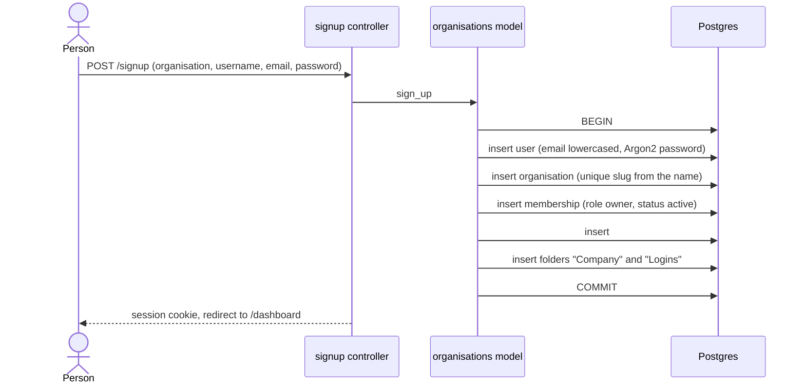
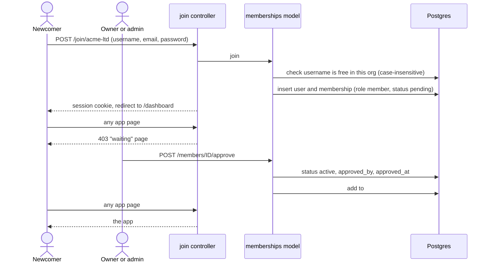
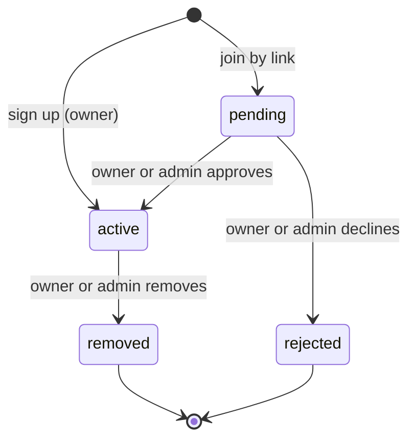
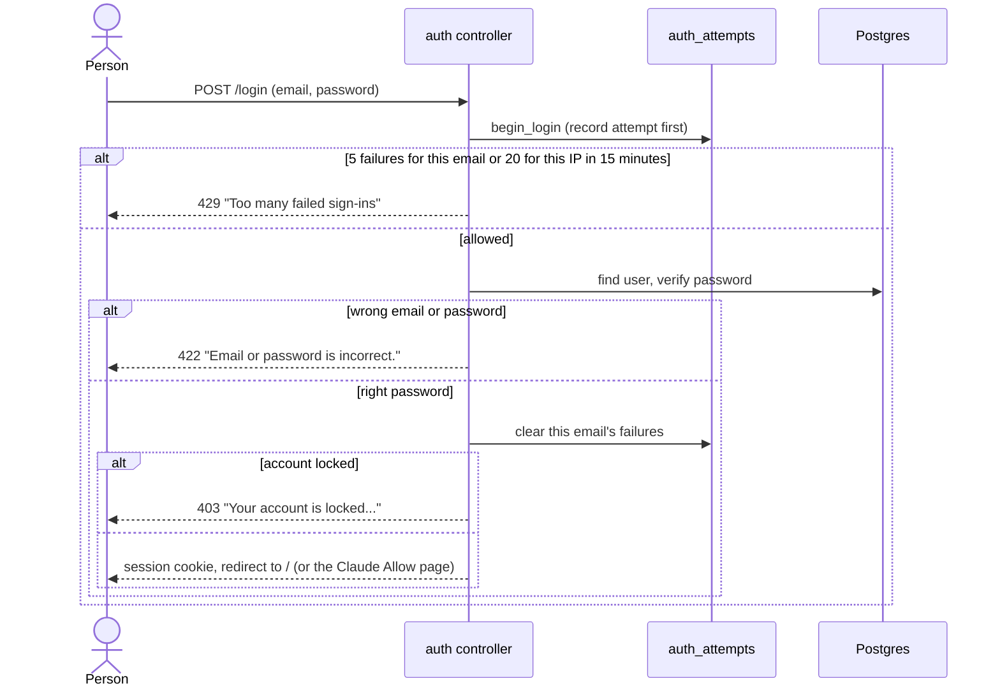
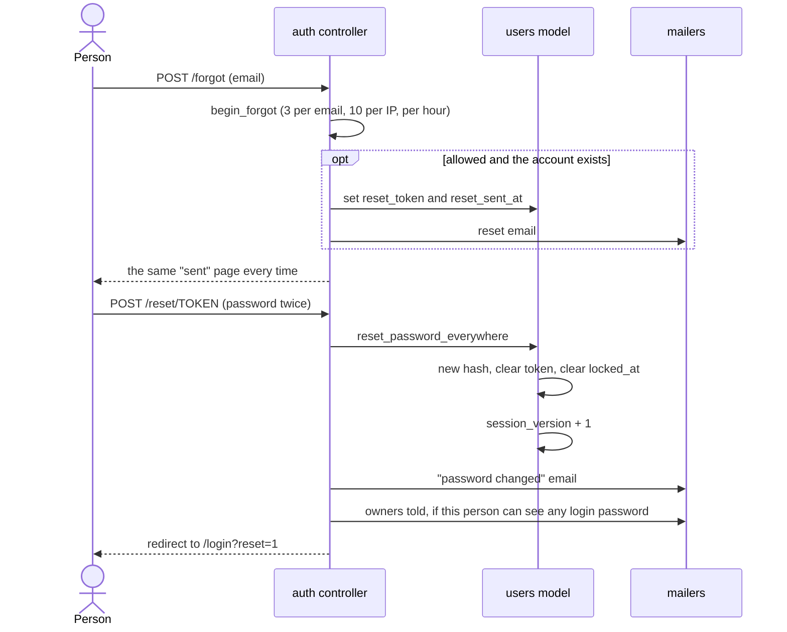
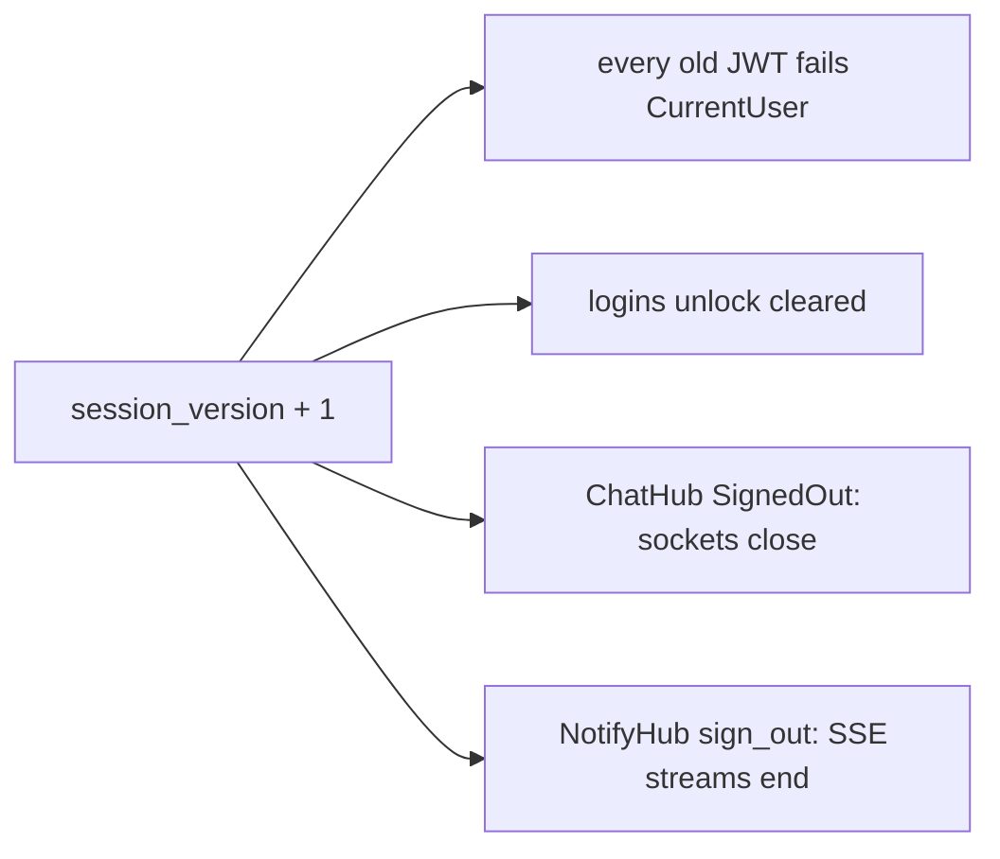

# Accounts and membership

How people get in: sign up a new organisation, join one by link, wait for
approval, sign in, reset a password and sign out everywhere.

Background: a session is a 7-day JWT in an `HttpOnly` cookie called
`auth_token` (`src/extractors/session.rs`). Each token carries the user's
`session_version` (claim `sv`) and a random sign-in id (claim `sid`).
`CurrentUser` refuses a token whose version no longer matches
(`src/models/users.rs`, `is_current_session`). `CurrentMember` then requires an
`active` membership (`src/extractors/current_member.rs:151`).

## Sign up a new organisation

Anyone can create an organisation at `/signup`. They become its owner.

Rules:

- Everything is in one transaction. If any step fails, nothing is saved
  (`src/models/organisations.rs:131`).
- Organisation name: 2 to 80 characters. Username: a letter, then letters or
  numbers, 3 to 30 characters, not `everyone`. Password: 8 to 128 characters.
- The slug comes from the name: "Acme Ltd!" becomes `acme-ltd`. A taken slug
  gets `-2`, `-3` and so on (`src/models/organisations.rs:179`).
- An email that already has an account gets "An account with this email
  already exists. Sign in instead." (status 422).
- A signed-in visitor to `/signup` is sent to `/dashboard`.

Files: `src/controllers/signup.rs:31`, `src/models/organisations.rs:131` and
`:157` (`create_with_owner`), `src/models/memberships.rs:75` (`create_owner`).

## Join by link, then owner approval

The join link is `/join/<slug>`. Joining makes a new account with a pending
membership. An owner or admin then approves or declines it.

Rules:

- Joining always creates a new account. An existing email is refused with the
  same "Sign in instead" message. So someone who already has an account
  cannot join a second organisation today.
- A signed-in visitor to `/join/<slug>` is sent to `/dashboard`.
- An unknown slug gets a 404 page.
- Approval adds the person to `#general` only. Groups and DMs are separate.
- Owners and admins see the number of waiting requests on the More page
  (`src/controllers/more.rs:19`). No notification or email is sent to them
  about a new request.
- Only a `pending` request can be approved or declined. Anything else shows an
  error toast (`src/models/memberships.rs:230` and `:248`).

Files: `src/controllers/join.rs:33`, `src/models/memberships.rs:98` (`join`),
`src/controllers/members.rs:150` (approve) and `:164` (reject).

## Membership states

What each state sees on any app page (`src/extractors/current_member.rs:211`):

| Status | Page | HTTP |
|---|---|---|
| `active` | the app | 200 |
| `pending` | `tenancy/waiting.html` | 403 |
| `rejected` | `tenancy/declined.html` | 403 |
| `removed` | `tenancy/removed.html` | 403 |
| no membership | `tenancy/no_org.html` (super admins go to `/admin`) | 403 |

There is no route that moves `rejected` or `removed` back to `pending` or
`active`.

A person with an active membership anywhere never sees these pages. They go
to their active organisation instead (see "Choosing an organisation").

## Choosing an organisation

A user can have one membership per organisation. The `current_org` cookie says
which organisation this browser is working in. It is only a hint: every
request checks it again.

`CurrentMember` picks the organisation in this order
(`src/extractors/current_member.rs`, `chosen_org`):

1. A super admin with a valid `acting_org`: that org (see
   [super-admin.md](super-admin.md)).
2. A `current_org` where the user has an `active` membership: that org.
3. Otherwise the default: the oldest active membership, else the oldest one.
   If a `current_org` cookie was sent (not a number, no access, a deleted
   org, any status but active), the response clears it
   (`src/initializers/current_org.rs`).

`POST /orgs/{id}/switch` is the only thing that sets the cookie
(`src/controllers/orgs.rs`). There is no button for it yet.

- It answers 404 unless the user has an active membership in that org, so it
  does not reveal whether the org exists.
- It sets `current_org` (`HttpOnly`, `SameSite=Lax`, 7 days like the session)
  and clears `acting_org`.
- It ends any logins unlock and closes the user's chat sockets and
  notification streams on every device. They reconnect in the new org.
- There is no GET that changes the org.

The Claude Allow page and the personal token form carry the org they were
shown for in a hidden `org_id`. If the browser has switched since, they are
refused and no code or token is made.

Until the stale-tab check ships (multi-org PR 3), a tab left open on one org
posts into whichever org the cookie names. Nobody has two orgs before PR 4.

### Removing a member

`POST /members/<id>/remove` (`src/models/memberships.rs:268`). In one
transaction that locks the organisation's owners:

- Only owners and admins can remove. Nobody removes themselves.
- Only an owner can remove an owner, and the last owner cannot be removed.
- Only `active` members can be removed.
- The membership becomes `removed`, with `removed_at` and `removed_by_id`.
- Their `session_version` goes up, so every session ends.
- Their Claude tokens in this organisation are revoked.
- They are taken out of every conversation in the organisation.
- Unsent mention emails to them are cancelled.
- A `member_removed` row is written to the login activity log.

After the commit, their open chat sockets and notification streams close. The
remover is then shown "Change these at the source": the logins the removed
person saw, copied, changed or could see (`src/controllers/members.rs:299`).

A super admin acting inside another organisation cannot remove anyone
(`require_own_membership`).

### Roles

- `owner`, `admin`, `member`. Owners and admins approve, decline, remove and
  set the organisation's time zone.
- Only an owner changes roles, between `admin` and `member`. An owner's role
  cannot be changed, and a pending member's role cannot be changed
  (`src/models/memberships.rs:348`).

## Sign in

Rules:

- The attempt is recorded before the password is checked, so attempts sent at
  the same moment see each other (`src/models/auth_attempts.rs:70`).
- An unknown email still runs a password hash, so the reply takes the same
  time (`src/controllers/auth.rs:23`).
- A lock lasts 15 minutes from the failure that started it. Refused attempts
  are deleted, so they do not stretch it.
- `next` is only honoured for `/oauth/authorize?...`, the Claude Allow page.
  Anything else is dropped (`src/controllers/auth.rs:57`).
- A locked account (`users.locked_at` set) cannot sign in until it resets its
  password. Accounts lock after 5 wrong app passwords when unlocking logins;
  see [documents.md](documents.md).
- Signing in clears `current_org` and `acting_org`, so each sign-in starts
  in the default organisation. Signing up and joining do the same. A cookie
  left by someone else on a shared browser never carries over.
- CSRF guard: a non-GET request that carries an `Origin` header must match
  `APP_URL`, or it gets 403. Requests with no `Origin` pass; browsers always
  send one on POST (`src/initializers/origin_check.rs`).

Files: `src/controllers/auth.rs:81`, `src/models/auth_attempts.rs:19` (limits).

## Password reset

Rules:

- The confirmation page is the same whether the email exists or a limit was
  hit, so the form cannot be used to find accounts.
- Reset links expire 60 minutes after they are sent and work once
  (`src/models/users.rs:26` and `:235`).
- A reset is the only way out of a lock (`src/models/users.rs:684`).
- The reset ends every session and closes live connections. It also clears
  failed sign-in and app-password counts for that email.
- Owners are emailed when the person can see at least one login's password,
  because someone who took over their email could now see those passwords
  (`src/controllers/auth.rs:250`).

Files: `src/controllers/auth.rs:181` (forgot) and `:222` (reset),
`src/models/users.rs:573` (`reset_password_everywhere`).

## Sign out, and sign out everywhere

- `POST /logout` clears the session cookie, `current_org` and the super
  admin's `acting_org` cookie on this browser. It does not change
  `session_version`, so it does not end other sessions
  (`src/controllers/auth.rs:130`).
- `POST /account/sign-out-everywhere` adds 1 to `session_version`. Every
  session token stops working, including this one. Open chat sockets and
  notification streams close. This browser then gets a fresh cookie and lands
  on `/more?signed_out=1`. It keeps its `current_org`, so it stays in the
  same organisation. Other browsers' `current_org` cookies do nothing without
  a session, and their next sign-in clears them. A `sign_out_everywhere` row goes into the login
  activity log (`src/controllers/auth.rs:145`).

The same bump happens on a password reset, on removal from an organisation
and when an account locks (`src/models/users.rs`, `increment_session_version`
and `close_live_connections`).
