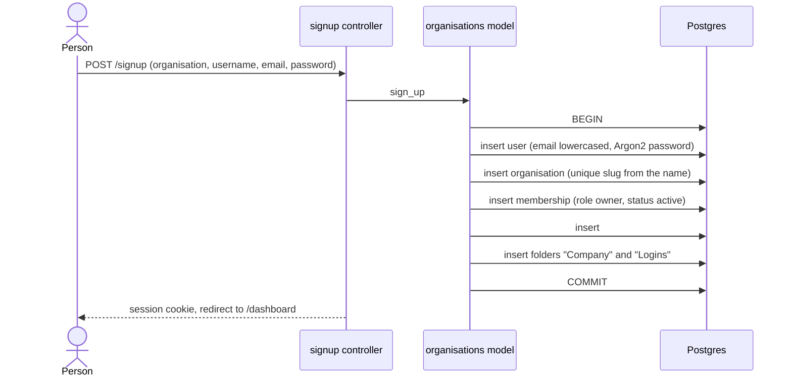
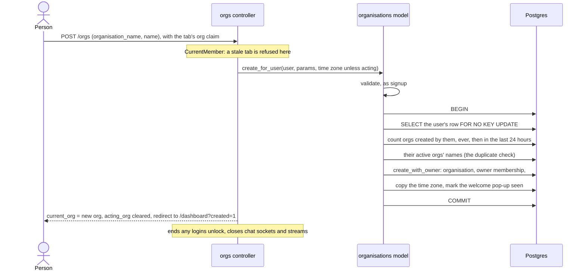
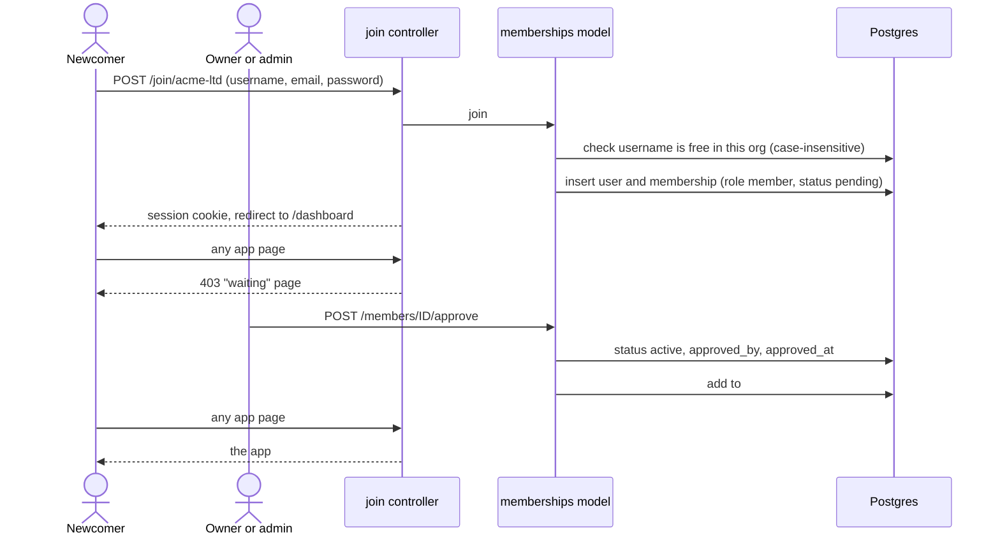
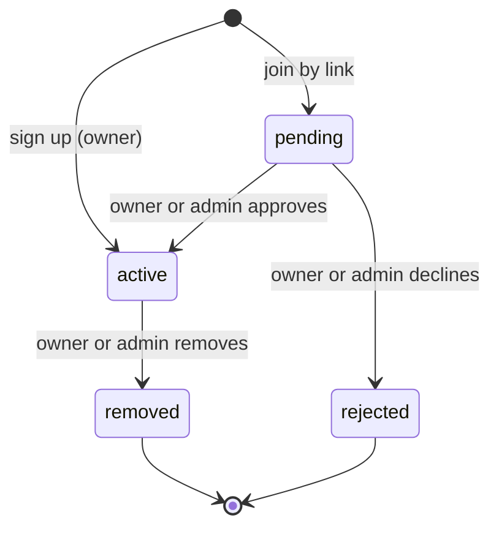
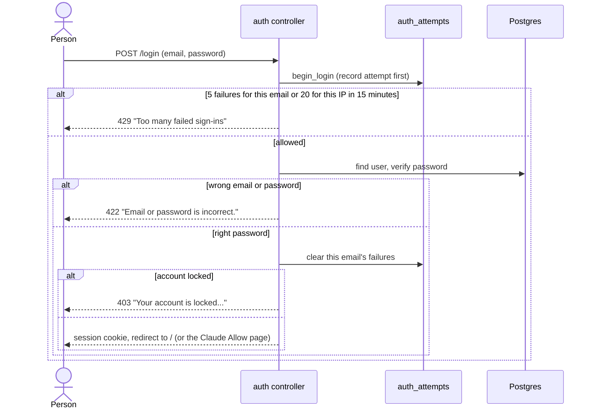
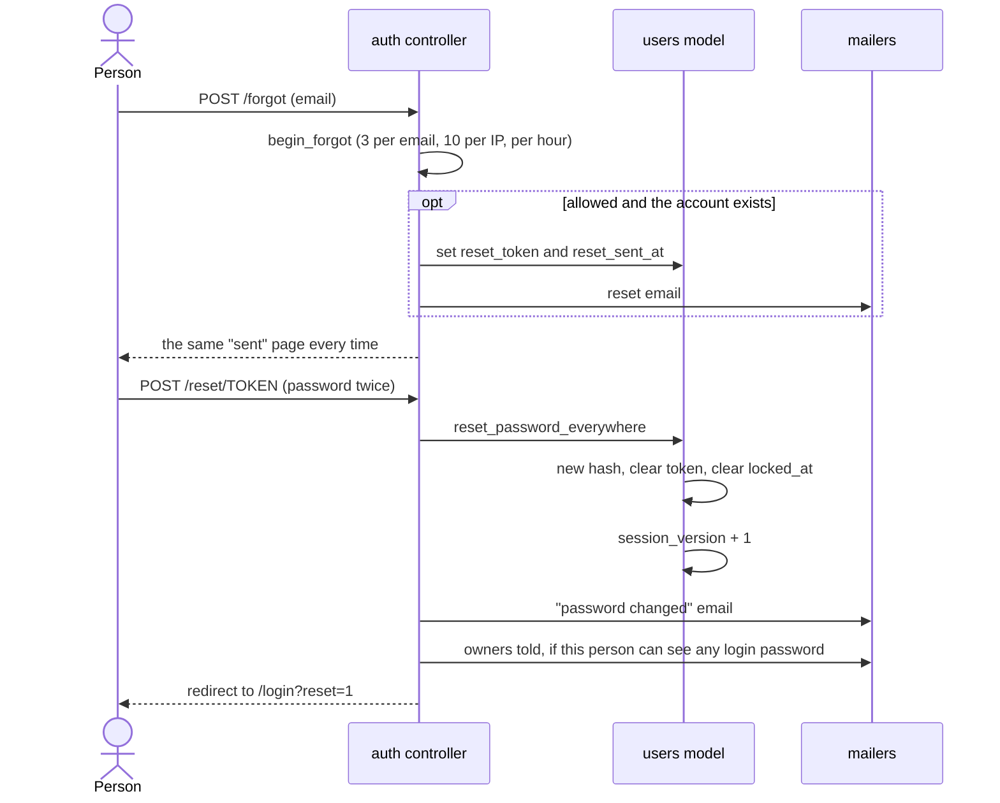
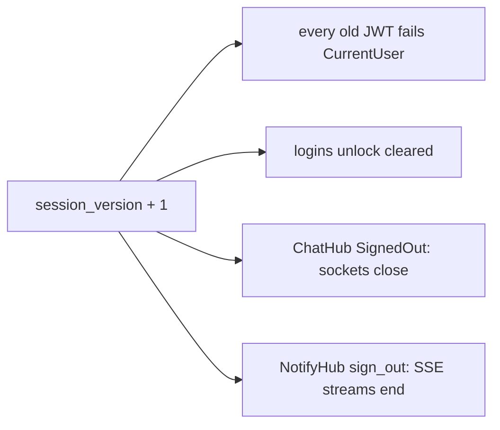

# Accounts and membership

How people get in: sign up a new organisation, create another one, join one
by link, wait for approval, sign in, reset a password and sign out
everywhere.

Background: a session is a 7-day JWT in an `HttpOnly` cookie called
`auth_token` (`src/extractors/session.rs`). Each token carries the user's
`session_version` (claim `sv`) and a random sign-in id (claim `sid`).
`CurrentUser` refuses a token whose version no longer matches
(`src/models/users.rs`, `is_current_session`). `CurrentMember` then requires an
`active` membership (`src/extractors/current_member.rs:219`).

## Sign up a new organisation

Anyone can create an organisation at `/signup`. They become its owner.

Rules:

- Everything is in one transaction. If any step fails, nothing is saved
  (`organisations::Model::sign_up`).
- The organisation and its owner membership, `#general` and the starter
  folders come from `create_with_owner`, which "Create another organisation"
  uses too (see below). Anything signup sets up later is set up there too.
- Organisation name: 2 to 80 characters once trimmed, so a name of only
  spaces is refused (`organisations::trimmed_name_length`). Username: a
  letter, then letters or numbers, 3 to 30 characters, not `everyone`.
  Password: 8 to 128 characters.
- The slug comes from the name: "Acme Ltd!" becomes `acme-ltd`. A taken slug
  gets `-2`, `-3` and so on (`unique_slug`). Accents are dropped today:
  "Lumen Café" becomes `lumen-caf`.
- An email that already has an account gets "An account with this email
  already exists. Sign in instead." (status 422).
- A signed-in visitor to `/signup` is sent to `/dashboard`.

Files: `src/controllers/signup.rs`, `src/models/organisations.rs`
(`sign_up`, `create_with_owner`), `src/models/memberships.rs`
(`create_owner`). The owner's username is the account's name here; the
create below passes the one chosen for the new org.

## Create another organisation

Anyone with an active membership can create another organisation from the
switcher's "New organisation" row, or at `/orgs/new`. They become its owner,
under a username they choose for it. Same account, same email and password.

Rules:

- `CurrentMember` on `GET /orgs/new` and `POST /orgs`, inside the stale-tab
  check. A pending, declined or removed person sees their waiting or removed
  page instead. The page form renders its own `_org`, so it works without
  JavaScript.
- Fields and messages are signup's: `organisations::NewOrgParams`. The form
  starts with your username in the current org.
- A name that matches one of your active orgs is refused: "You already have
  an organisation called Acme Studio. Pick a name you can tell apart." It
  compares trimmed, with runs of spaces as one, lowercase. Other people's
  names don't count, nor do orgs you are only waiting for.
- Limits: 10 organisations created per person, ever, counting the signup one
  (`MAX_ORGS_CREATED`), and 3 in any 24 hours (`ORGS_PER_DAY`). Both are
  counted from `organisations.created_by_id` and `created_at`, so leaving an
  org frees nothing. At 10 the form says so instead of showing its fields; a
  `POST` gets the same as a 422. Over the daily limit: a 422 with "You've
  set up 3 organisations today. Try again tomorrow."
- The user-row lock makes two creates at once run one after the other, so
  both limits and the duplicate check see each other. `FOR NO KEY UPDATE`
  doesn't block inserts elsewhere that point at the user.
- The time zone is copied from the current org. Not while acting: the new org
  keeps `Europe/London`, as at signup.
- The new membership has `welcomed_at` set, so Home skips the welcome
  pop-up. The "Getting started" checklist still shows, with the owner's
  steps.
- After creating, the browser moves in the way a switch does (the shared
  `enter_org` in `src/controllers/orgs.rs`). It lands on
  `/dashboard?created=1`, a constant, where Home shows "Lumen Café is ready.
  You're the owner.", named from the org the request resolved. The page is
  `no-store` and `app.ts` drops `?created=1` from the address.
- No email or notification is sent. The log line "created organisation"
  has numbers only: `user_id`, `org_id`, `from_org` and, while acting,
  `acting_org`.
- There is no delete or leave yet. A mistaken org stays until removed by
  hand; the cap bounds how many.

Files: `src/controllers/orgs.rs` (`new`, `create`, `enter_org`),
`src/models/organisations.rs` (`create_for_user`, `created_count`),
`assets/views/orgs/_new_form.html`.

## Join by link, then owner approval

The join link is `/join/<slug>`. Joining makes a new account with a pending
membership. An owner or admin then approves or declines it.

Rules:

- Joining always creates a new account. An existing email is refused with the
  same "Sign in instead" message. So someone who already has an account
  cannot join a second organisation today.
- A signed-in visitor to `/join/<slug>` is sent to `/dashboard`.
- An unknown slug gets a 404 page.
- Approval adds the person to `#general` only. Groups and DMs are separate.
- Owners and admins see the number of waiting requests on the More page
  (`src/controllers/more.rs:19`). No notification or email is sent to them
  about a new request.
- Only a `pending` request can be approved or declined. Anything else shows an
  error toast (`src/models/memberships.rs:230` and `:248`).

Files: `src/controllers/join.rs:33`, `src/models/memberships.rs:98` (`join`),
`src/controllers/members.rs:150` (approve) and `:164` (reject).

## Membership states

What each state sees on any app page (`src/extractors/current_member.rs:277`):

| Status | Page | HTTP |
|---|---|---|
| `active` | the app | 200 |
| `pending` | `tenancy/waiting.html` | 403 |
| `rejected` | `tenancy/declined.html` | 403 |
| `removed` | `tenancy/removed.html` | 403 |
| no membership | `tenancy/no_org.html` (super admins go to `/admin`) | 403 |

There is no route that moves `rejected` or `removed` back to `pending` or
`active`.

A person with an active membership anywhere never sees these pages. They go
to their active organisation instead (see "Choosing an organisation").

## Choosing an organisation

A user can have one membership per organisation. The `current_org` cookie says
which organisation this browser is working in. It is only a hint: every
request checks it again.

`CurrentMember` picks the organisation in this order
(`src/extractors/current_member.rs`, `chosen_org`):

1. A super admin with a valid `acting_org`: that org (see
   [super-admin.md](super-admin.md)).
2. A `current_org` where the user has an `active` membership: that org.
3. Otherwise the default: the oldest active membership, else the oldest one.
   If a `current_org` cookie was sent (not a number, no access, a deleted
   org, any status but active), the response clears it
   (`src/initializers/current_org.rs`).

`POST /orgs/{id}/switch` sets the cookie (`src/controllers/orgs.rs`). The
switcher calls it (see "The switcher"). `POST /orgs` sets it too, to the org
it just created, through the same `enter_org` (see "Create another
organisation").

- It answers 404 unless the user has an active membership in that org, so it
  does not reveal whether the org exists.
- It sets `current_org` (`HttpOnly`, `SameSite=Lax`, 7 days like the session)
  and clears `acting_org`.
- It ends any logins unlock and closes the user's chat sockets and
  notification streams on every device. They reconnect in the new org.
- It lands on `/dashboard?switched=1`, a constant: it ignores any `next`.
  Home then shows "You're now in Northwind Bakery", named from the org the
  request resolved, never from the URL.
- There is no GET that changes the org.

The Claude Allow page and the personal token form carry the org they were
shown for in a hidden `org_id`. If the browser has switched since, they are
refused and no code or token is made.

### The switcher

For every member who is not acting, even with one org, the org name at the
top of the sidebar opens a menu of your organisations. On phones, Home's
header name opens the same list in a sheet. The list ends with "New
organisation", a link to `/orgs/new` outside the switch form, which opens the
form as a dialog on desktop and in place of the list on a phone.
`CurrentMember.org_menu` decides this, on full page loads only. For members
it costs no query. While acting it needs an org of their own
(`memberships::Model::switcher_counts`, one indexed query), and the menu has
no "New organisation" row.

More's "Organisation" section shows for everyone: the current org, with
"Switch" only when there is another org (or a pending request) to switch to,
then "New organisation" (not while acting).

The rows come from `GET /orgs` (`memberships::Model::for_user_with_orgs`):
active A to Z, then pending, greyed. Declined and removed are not listed.
Over HTMX it is a fragment for the menu or sheet; without JavaScript it is a
page, and each row is a plain form button. Both are `no-store`.

### Stale tabs

The cookie is per browser, so a switch in one tab moves every tab. A tab
left on the old org must not write into the new one.

- Every app page says which org it was drawn for: `data-org-id` and
  `hx-headers='{"X-Org-Id": <id>}'` on `<body>` (`layouts/base.html`).
- HTMX sends the header. Plain forms get a hidden `_org` from a submit
  listener in `frontend/app.ts`. The raw `fetch` calls add the header
  through `orgHeaders()`.
- The `current-org` layer (`src/initializers/current_org.rs`) reads the
  header, or `_org` from a signed-in urlencoded body, into an `OrgClaim`. It
  puts the body back for `Form`. Over 2 MB is a 413, as `Form` would.
- `CurrentMember` compares the claim with the org it resolved (the acting
  org while acting). Plain GET page loads are never checked. HTMX GETs with
  no claim pass, so tabs from before the deploy keep polling. Anything else
  that is missing, garbage or another org is refused: 409 with
  `HX-Redirect: /dashboard?from=<id>` for HTMX and `fetch`, 303 for a plain
  form. Only a parsed number goes into that address.
- Home then shows a notice: "This tab was showing Acme Studio. You're now in
  Northwind Bakery." It names the old org, with "Back to Acme Studio", only
  if you are an active member there. Nothing was saved.
- A tab holding typed text or an upload does not move. It shows one banner
  in place, keeps the text, and offers "Back to Acme Studio" (which switches
  the browser back without leaving the page) and "Go to Home".
- `app.ts` also asks `GET /orgs/current` when the chat socket closes, when
  the notification stream comes back, on a back or forward load and before
  each upload, so a stale tab moves within seconds.
- The check runs when a request starts. An upload already in flight when a
  switch happens finishes into the org the page showed. The person is still
  a member there, so it is not a cross-org write.

The Claude Allow page and the token form keep their own `org_id` pin and
skip this check (`PinnedMember`), so they can answer better than the generic
refusal. The route walk in `tests/requests/stale_tab.rs` lists every route
that skips the check.

### Removing a member

`POST /members/<id>/remove` (`src/models/memberships.rs:268`). In one
transaction that locks the organisation's owners:

- Only owners and admins can remove. Nobody removes themselves.
- Only an owner can remove an owner, and the last owner cannot be removed.
- Only `active` members can be removed.
- The membership becomes `removed`, with `removed_at` and `removed_by_id`.
- Their `session_version` goes up, so every session ends.
- Their Claude tokens in this organisation are revoked.
- They are taken out of every conversation in the organisation.
- Unsent mention emails to them are cancelled.
- A `member_removed` row is written to the login activity log.

After the commit, their open chat sockets and notification streams close. The
remover is then shown "Change these at the source": the logins the removed
person saw, copied, changed or could see (`src/controllers/members.rs:299`).

A super admin acting inside another organisation cannot remove anyone
(`require_own_membership`).

### Roles

- `owner`, `admin`, `member`. Owners and admins approve, decline, remove and
  set the organisation's time zone.
- Only an owner changes roles, between `admin` and `member`. An owner's role
  cannot be changed, and a pending member's role cannot be changed
  (`src/models/memberships.rs:348`).

## Sign in

Rules:

- The attempt is recorded before the password is checked, so attempts sent at
  the same moment see each other (`src/models/auth_attempts.rs:70`).
- An unknown email still runs a password hash, so the reply takes the same
  time (`src/controllers/auth.rs:23`).
- A lock lasts 15 minutes from the failure that started it. Refused attempts
  are deleted, so they do not stretch it.
- `next` is only honoured for `/oauth/authorize?...`, the Claude Allow page.
  Anything else is dropped (`src/controllers/auth.rs:57`).
- A locked account (`users.locked_at` set) cannot sign in until it resets its
  password. Accounts lock after 5 wrong app passwords when unlocking logins;
  see [documents.md](documents.md).
- Signing in clears `current_org` and `acting_org`, so each sign-in starts
  in the default organisation: the oldest active one, not the newest
  created. Signing up and joining do the same. A cookie left by someone else
  on a shared browser never carries over.
- CSRF guard: a non-GET request that carries an `Origin` header must match
  `APP_URL`, or it gets 403. Requests with no `Origin` pass; browsers always
  send one on POST (`src/initializers/origin_check.rs`).

Files: `src/controllers/auth.rs:81`, `src/models/auth_attempts.rs:19` (limits).

## Password reset

Rules:

- The confirmation page is the same whether the email exists or a limit was
  hit, so the form cannot be used to find accounts.
- Reset links expire 60 minutes after they are sent and work once
  (`src/models/users.rs:26` and `:235`).
- A reset is the only way out of a lock (`src/models/users.rs:684`).
- The reset ends every session and closes live connections. It also clears
  failed sign-in and app-password counts for that email.
- Owners are emailed when the person can see at least one login's password,
  because someone who took over their email could now see those passwords
  (`src/controllers/auth.rs:250`).

Files: `src/controllers/auth.rs:181` (forgot) and `:222` (reset),
`src/models/users.rs:573` (`reset_password_everywhere`).

## Sign out, and sign out everywhere

- `POST /logout` clears the session cookie, `current_org` and the super
  admin's `acting_org` cookie on this browser. It does not change
  `session_version`, so it does not end other sessions
  (`src/controllers/auth.rs:130`).
- `POST /account/sign-out-everywhere` adds 1 to `session_version`. Every
  session token stops working, including this one. Open chat sockets and
  notification streams close. This browser then gets a fresh cookie and lands
  on `/more?signed_out=1`. It keeps its `current_org`, so it stays in the
  same organisation. Other browsers' `current_org` cookies do nothing without
  a session, and their next sign-in clears them. A `sign_out_everywhere` row goes into the login
  activity log (`src/controllers/auth.rs:145`).

The same bump happens on a password reset, on removal from an organisation
and when an account locks (`src/models/users.rs`, `increment_session_version`
and `close_live_connections`).
