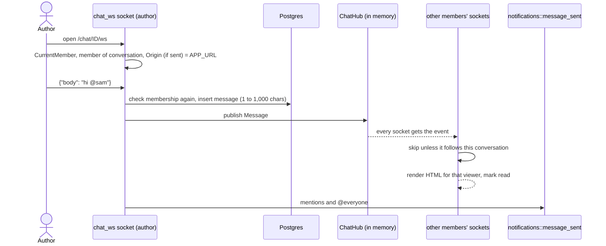
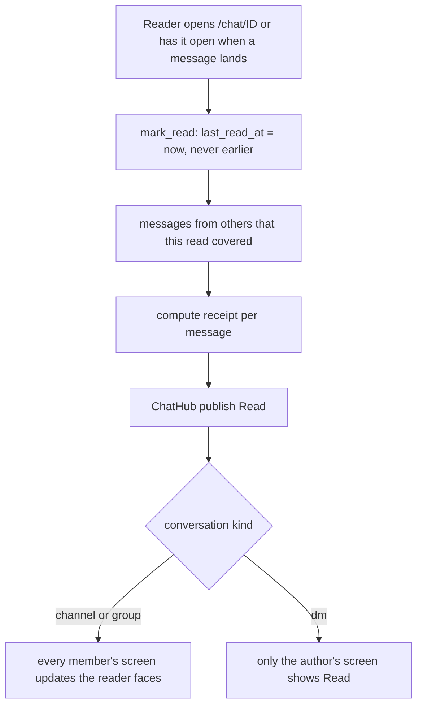
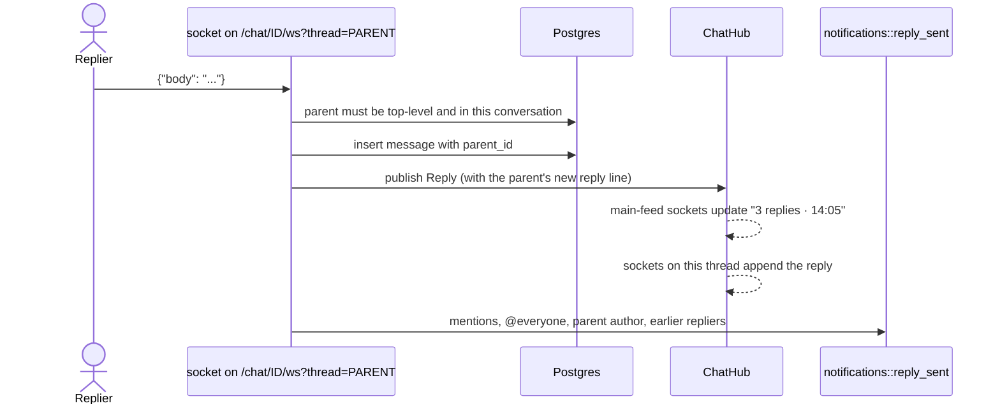

# Chat

Members talk in conversations. Messages arrive live over a WebSocket, with a
plain HTTP fallback. Members see who read what, react with six emoji, and
reply in threads.

## Channels, groups and DMs

`conversations.kind` is one of three values (`src/models/conversations.rs:22`):

| Kind | Who is in it | How it is made |
|---|---|---|
| `channel` | Everyone approved | Only `#general` exists. It is made with the organisation. Approval adds each new member to it. There is no route to create another channel. |
| `group` | The creator and the teammates they picked | `POST /chat/groups`. Any member. Name up to 40 characters. Members must be active. There is no route to add or remove members later. |
| `dm` | Two people | `POST /chat/dms`. Made the first time, then reused. `dm_key` is `dm:<lower id>:<higher id>`, unique per organisation. |

Access rules:

- A person sees only conversations they are a member of
  (`list_for_user`, `src/models/conversations.rs:87`).
- Any other conversation id is "not found", so private groups and DMs are not
  revealed (`find_for_member`, `src/models/conversations.rs:116`).
- Removing someone from the organisation deletes their
  `conversation_members` rows everywhere, so they lose every conversation.

## Sending a message

Rules:

- The socket checks the session, the membership and the `Origin` before it
  upgrades (`src/controllers/chat_ws.rs:58`). It checks the session version,
  the active membership in the org and the conversation seat again when it
  starts (`still_allowed`), after subscribing, so a close published between
  the two is never missed.
- Every message sent on the socket checks membership again
  (`receive`, `src/controllers/chat_ws.rs:241`).
- `ChatHub` is one `tokio` broadcast channel for the whole process. Each
  socket filters events by conversation (and thread) itself (`wants`, `:476`).
  Because it lives in memory, the app must run as one instance
  (`docs/deploy.md`).
- A socket that falls behind closes. The browser reconnects through the same
  checks and reloads the feed from `GET /chat/<id>/feed`.
- A `Close` event closes sockets by scope (`src/data/live.rs`): every org's
  on sign out everywhere, a password reset or a lock (`Account`); only that
  org's, on every device, on removal (`Org`); only that browser's on a switch
  or a create (`Browser`, by sign-in id).
- The socket needs no stale-tab check. Its org is fixed at upgrade, and the
  upgrade only succeeds for a conversation in the cookie's org, the one the
  page names. A switch closes the socket and its reconnect is refused. The
  `X-Org-Id` in each message's headers is ignored.
- When a socket closes, `app.ts` asks `GET /orgs/current`. A tab left on the
  old org gets the refusal and moves to Home, instead of sitting there with
  no new messages.
- HTTP fallback: `POST /chat/<id>/messages` saves, publishes and notifies the
  same way (`src/controllers/chat.rs:664`).

## Read receipts and unread counts

All of this comes from one column: `conversation_members.last_read_at`.

Rules (`receipt`, `src/controllers/chat.rs:288`):

- A member has read a message once their `last_read_at` reaches its
  `created_at`. Reading is in order.
- The author never counts as a reader. People no longer on the team do not
  show.
- Nothing shows until at least one person has read the message.
- Groups and channels: every member sees who read every message, as up to
  three faces plus "+N", labelled "Read by ...". This is public since PR #40
  (`shows_receipt`, `src/controllers/chat.rs:350`).
- DMs: only the author sees a receipt, and it says "Read".
- The tick turns "read" when everyone who was in the conversation when the
  message was sent has read it. Someone who joined later does not hold it
  back.
- The server sets a receipt on every message. The stylesheet shows it only
  under the last message of each run (`frontend/styles/app.css`, commit
  2f8bd5f).
- Sending your own message only touches `last_read_at`. It does no receipt
  work (`read_on_socket`, `src/controllers/chat_ws.rs:217`).
- Unread counts: messages after `last_read_at` from other people. Your own
  messages and thread replies do not count. Before your first visit, counting
  starts from when you joined (`src/models/conversation_members.rs:151`).
- Threads have no receipts. Opening a thread page does not mark the
  conversation read.

## Reactions

- `POST /chat/<id>/messages/<message_id>/reactions` with `emoji` and `on`
  (`1` add, `0` remove). The client sends the state it wants, so a double tap
  changes nothing (`src/models/reactions.rs:39`).
- Allowed: 👍 ❤️ 😂 🎉 👀 ✅. Anything else is refused. One row per person,
  message and emoji (unique index).
- After a change, the full set for that message is read and published as a
  `Reactions` event. Each socket renders it for its own viewer.
- Reactions send no notification.
- Reactions from people who left show as "Former member" and still count.

## Threads

Rules:

- Threads are one level deep. A reply cannot have replies. The parent comes
  from the socket's session, never from the browser
  (`src/controllers/chat_ws.rs:241`).
- Replies are not in the main feed and not in the chat list preview.
- HTTP fallback: `POST /chat/<id>/threads/<message_id>/replies`
  (`src/controllers/chat.rs:962`).
- A thread you cannot see and one that does not exist get the same 404.

## @mentions and @everyone in chat

From `src/controllers/notifications.rs:269` (`message_sent`) and `:338`
(`reply_sent`):

- A named teammate is told only if they are a member of the conversation.
  Mentioning someone outside a group or DM does nothing.
- `@everyone` tells the conversation's other members, once each. People also
  named get "mentioned you" instead.
- The @ menu does not offer `@everyone` in a DM
  (`src/controllers/chat.rs:573`). The server does not block it, so typed by
  hand in a DM it tells the other person.
- Thread replies also tell the parent's author ("replied to your message")
  and earlier repliers ("replied in a thread"). Each person gets one notice.
- Tagging yourself notifies you, as with task notes.

## Files

- `src/controllers/chat.rs`: pages, HTTP fallbacks, receipts, reactions.
- `src/controllers/chat_ws.rs`: the socket, `receive`, `publish`, `mark_read`.
- `src/data/chat_hub.rs`: the in-memory broadcast and its event types.
- `src/models/conversations.rs`, `conversation_members.rs`, `messages.rs`,
  `reactions.rs`.
- `docs/notes/websocket-spike.md`: why the socket is built this way.
