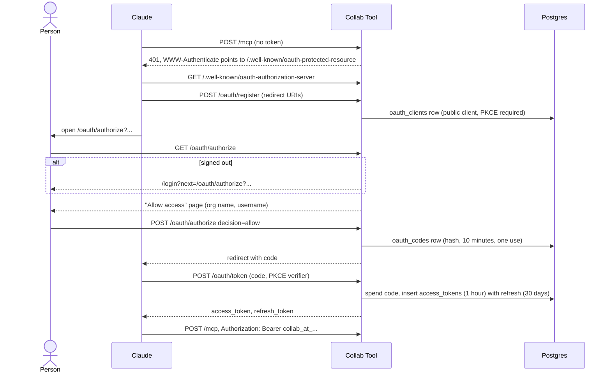
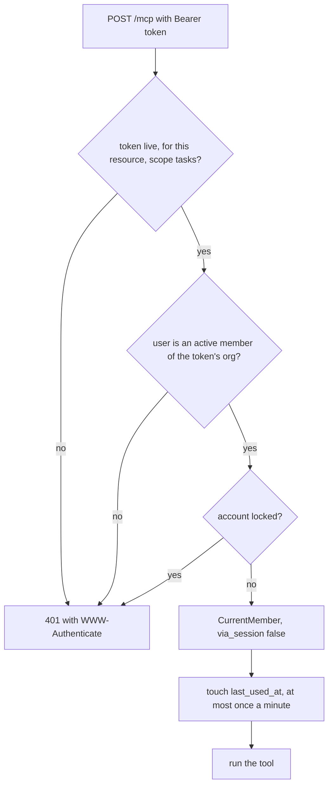

# Claude connector

Claude connects over MCP (Model Context Protocol) at `POST /mcp`. Every call
acts as one person, in that person's organisation, with the same checks as
the web app. It can read and change projects, tasks and task notes. It
cannot see chat, meetings, documents or members' emails.

The detailed design note is [`docs/notes/claude-connector.md`](../notes/claude-connector.md).
This page is the flow view, checked against the code.

## Connect with OAuth

Rules:

- Registration always makes a public client and requires PKCE S256. Redirect
  URIs must be on an allowlist: claude.ai and claude.com callbacks, or a
  loopback `/callback` for Claude Code (`src/models/oauth_clients.rs:19`).
- The Allow page is never framed or cached. Unknown clients and bad redirect
  URIs get an error page, never a redirect.
- The Allow form is checked again on POST (`src/controllers/oauth.rs:352`).
- The Allow form carries the organisation it was shown for. If the browser
  switched organisation since, Allow is refused and no code is issued. Deny
  still goes through. The handler takes `PinnedMember`, so it skips the
  generic stale-tab check (see [accounts.md](accounts.md), "Stale tabs"),
  which would answer first and lose the `access_denied` to Claude.
- A super admin acting inside another organisation sees a "leave first" page
  instead (`src/controllers/oauth.rs:270`).
- Codes and tokens are stored only as SHA-256 hashes.
- Refresh tokens rotate on every use. Using a code twice, or a refresh token
  that was already swapped, revokes the whole grant
  (`src/models/access_tokens.rs:192` and `:235`).
- Tokens are bound to the resource `{APP_URL}/mcp`. Changing `APP_URL`
  invalidates every token.
- Old rows are pruned on each `/oauth/token` call
  (`src/models/access_tokens.rs:428`).

## Personal tokens

- Made at More, Connect Claude (`POST /settings/claude/tokens`,
  `src/controllers/claude.rs:98`). Shown once, prefixed `collab_pat_`.
- The form carries the organisation it was shown for. After a switch it is
  refused with a 409 and no token is made. It keeps the typed name and shows
  its own message: it takes `PinnedMember`, which skips the generic
  stale-tab check.
- They do not expire. At most 10 live ones per person.
- Not available while a super admin is acting in another organisation.
- Revoke at `POST /settings/claude/grants/<grant_id>/revoke`. Revoking ends
  every token in that grant.

## Every MCP call

The gate is `require_bearer` in `src/extractors/bearer.rs:19`. The app-wide
Origin check also applies: a request with an `Origin` header other than
`APP_URL` gets 403, and one with no `Origin` passes. The member the gate
builds has `via_session = false` and `acting = false`.

## What the tools can do

Tools are in `src/mcp/mod.rs:285`. One scope, `tasks`.

| Tool | Does | Notifies |
|---|---|---|
| `list_projects` | Projects with lane, status, owner and progress | |
| `create_project` | Adds a project to a lane | The owner, if set |
| `list_members` | Active members: username and role, never email | |
| `list_tasks` | Filter by project, status, assignee or title text | |
| `get_task` | One task with its notes | |
| `create_task` | Adds a task | Assignees, and the project owner |
| `update_task` | Changes only the fields sent; `assignees` replaces the list | As for the web app |
| `add_task_note` | Adds a note | `@username` mentions and the task's assignees |

Limits:

- No `@everyone`. A note with `@everyone` saves, but the `@everyone` part
  notifies nobody, because `via_session` is false
  (`src/controllers/notifications.rs:192`).
- No deletes, no member or role changes, no chat, meetings, documents or
  admin.
- No login passwords: `can_reveal` is false without a browser session.
- Validation is the same as the web app: tools save through the same model
  methods (`tasks::Model::create`, `update_from`, `task_notes::Model::create`).

## When access ends

- The person revokes the connection.
- The person is removed from the organisation: all their tokens there are
  revoked (`src/models/access_tokens.rs:316`).
- The account locks after 5 wrong app passwords: tokens are revoked in every
  organisation.
- The person resets their password: tokens are revoked in every
  organisation, and the email says how to connect Claude again.
- Minting a token (`create_personal`, `exchange_code`, `refresh`) reads the
  membership, then the user row, `FOR SHARE`. One racing a removal waits and
  is refused. One racing a reset or a lock either waits for it, or is
  revoked by it. Locks are always taken membership, user, tokens, the order
  a removal, a reset and a lock use, so they never deadlock.
- Every call checks membership and the lock, so a token stops working at
  once even before revocation.
