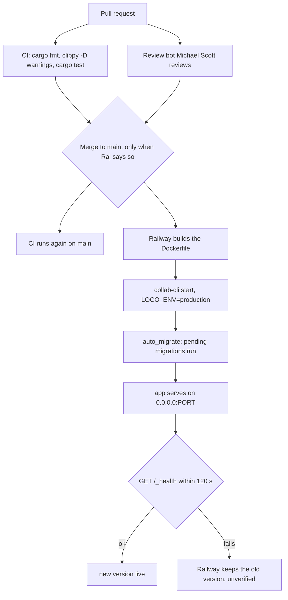

# Deploy

Merging to `main` ships to production at collab.rajgurung.me. Railway builds
the Docker image and starts it, and the app runs any new migrations as it
boots. The setup steps and variables are in [`docs/deploy.md`](../deploy.md).

## From pull request to production

## What the repo says

- CI (`.github/workflows/ci.yaml`) runs on every pull request and on every
  push to `main`: `cargo fmt --all -- --check`, `cargo clippy --all-targets
  -- -D warnings`, `cargo test --all`.
- The review bot runs on pull requests that are opened, updated, reopened or
  marked ready (`.github/workflows/claude-code-review.yml`).
- `railway.toml` tells Railway to build `Dockerfile`, check `/_health` with a
  120 second timeout, and restart on failure up to 5 times.
- The image runs `/usr/app/collab-cli start` with `LOCO_ENV=production`
  (`Dockerfile`).
- `config/production.yaml` sets `auto_migrate` from `DB_AUTO_MIGRATE`,
  default `true`. So migrations run when the app starts, before it serves.
- Production refuses to boot if a required variable is missing. That
  includes `DATABASE_URL`, `JWT_SECRET`, `APP_URL`, the mailer settings, the
  `R2_*` settings and `SECRETS_KEK`.

## What lives outside the repo

These come from the team's notes and the README. They are not in any file in
this repo, so treat them as unverified here:

- Railway deploys automatically on every push to `main`. The trigger is set
  in Railway, not in `railway.toml`.
- `main` is protected and needs one approval.
- Whether Railway waits for CI to pass before deploying.
- What Railway does with the old container when the new one fails its health
  check.

## Migrations

- Each migration is a file in `migration/src/`, listed in
  `migration/src/lib.rs`. They run in order, once, at boot.
- Every migration has a `down`. Deploys never run `down`; rolling back is a
  manual step.
- Some `down` steps lose data or can fail. Examples:
  - `m20261008_165224_allow_tasks_without_project`: rolling back fails while
    any task has no project.
  - `m20261008_162805_remove_progress_from_projects`: the column comes back
    at 0.
  - `m20261012_181452_add_removed_to_memberships`: removed members become
    `rejected`.
- The project CLAUDE.md asks every PR with a migration to say what it does
  and whether it can be rolled back.

## Why one instance

Three things live in the app's memory, so the service must run as one
replica:

- `ChatHub`: the live chat broadcast (`src/data/chat_hub.rs`).
- `NotifyHub`: the bell's live updates (`src/data/notify_hub.rs`).
- The mention email loop (`src/initializers/mention_emails.rs`). It is safe
  across restarts, because it marks rows emailed before sending.

`auto_migrate` at boot also assumes one instance. The comment in
`config/production.yaml` says to turn it off if more than one instance runs,
so they do not race.
