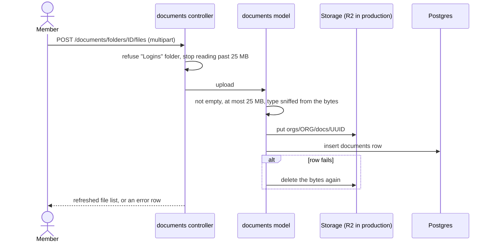
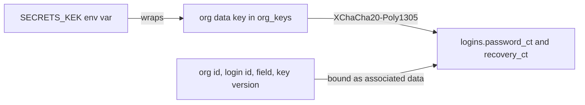
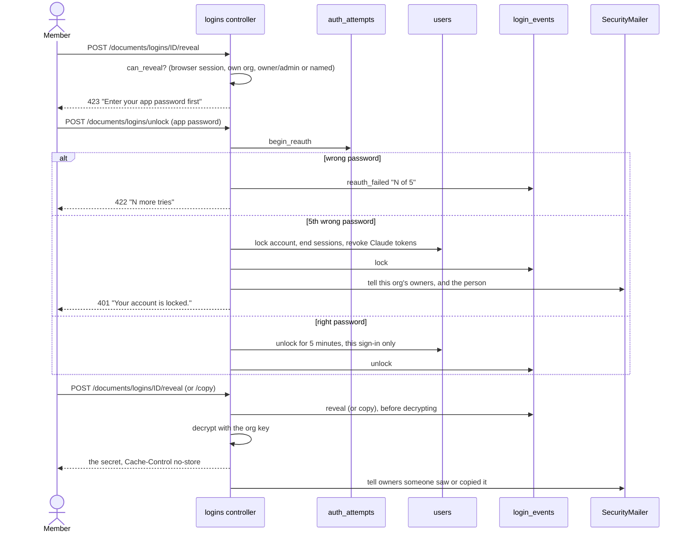

# Documents and logins

The Documents space holds an organisation's files and shared logins, in
folders one level deep. Files go to object storage. Login passwords are
encrypted. Seeing a password needs the app password again, and every look is
logged.

Every Documents and Logins route calls `require_own_membership`, so a super
admin acting inside another organisation gets 403. Every Documents page is
sent with headers that stop it being shown in a frame (`no_framing`,
`src/controllers/documents.rs:544`).

## Who can do what

| Action | Who |
|---|---|
| See folders, files and login titles | Any member |
| Upload, open and rename a file | Any member |
| Delete a file | The uploader, owners and admins |
| Add, rename or delete a folder | Owners and admins |
| Add, change or delete a login | Owners and admins |
| See or copy a login's password | Owners, admins, and members named on that login, in the browser |
| Read the login activity log | Owners |

## Folders

- Every organisation starts with "Company" and "Logins"
  (`src/models/folders.rs:21`).
- Names are unique per organisation, ignoring case.
- The "Logins" folder holds logins only. Uploading a file there is refused.
- A folder can be deleted only when it is empty. The database also refuses it
  (`NO ACTION` foreign keys), so a file added at the same moment cannot be
  orphaned.

## Upload a file

Rules (`src/models/documents.rs:199`):

- Allowed types: JPEG, PNG, WebP, HEIC, HEIF, PDF, and Word, Excel and
  PowerPoint (old and new formats). The type comes from the file's first
  bytes, not its name. SVG, HTML, XML and text are refused.
- The stored name keeps the uploaded stem and gets the extension of the real
  type. Names are cut to 200 characters.
- Storage: Cloudflare R2 in production, `tmp/storage` on disk in development,
  memory in tests (`src/app.rs`, `document_storage`).
- Opening a file (`GET /documents/files/<id>`) shows photos and PDFs in the
  browser and downloads everything else. It is sent with `nosniff`,
  `private, no-store` and a Content-Security-Policy.
- Deleting removes the bytes first, then the row. If the bytes cannot be
  deleted, the row stays so the delete can be retried. There is no bin.
- File uploads, renames and deletes are not written to the activity log.

Files: `src/controllers/documents.rs:404` (upload), `:449` (open), `:524`
(delete); `src/models/documents.rs`.

## Logins: storing a secret

- Owners and admins add a login with a title, username, URL, notes, password,
  optional recovery codes, and the members who may see the password.
- The password and recovery codes are encrypted under the organisation's
  data key. The key is made the first time the organisation needs one
  (`src/models/org_keys.rs:22`).
- Title, username, URL and notes are plain text. The "Logins" folder's note
  says "Never put passwords in notes."
- Members named on a login must be active members.
- The app will not start in production without a valid `SECRETS_KEK`, or with
  the development key (`docs/deploy.md`).

Files: `src/models/logins.rs:257` (create), `:324` (edit), `:390` (delete),
`src/models/secrets/crypto.rs`.

## Logins: unlock, then reveal or copy

Rules:

- `can_reveal` is false for Claude's bearer tokens, for an acting super
  admin, and for a login in another organisation. Otherwise owners and admins
  can, and so can members named on the login (`src/models/logins.rs:446`).
- The unlock lasts 5 minutes and is tied to the sign-in id in the session
  cookie, so unlocking on one device does not unlock another. It is also tied
  to the organisation it happened in, so it never counts in another one.
  Switching organisation in this browser ends it; a switch in another browser
  doesn't. Removal from that organisation ends it; removal from another one
  doesn't (`end_unlock_in`). Unlocking reads the membership `FOR SHARE`, so
  it can't slip in while a removal commits.
- 5 wrong app passwords lock the account until a password reset
  (`src/models/auth_attempts.rs:29`). Too many tries from one IP gives 429
  for 15 minutes instead.
- A lock revokes the person's Claude tokens and unused OAuth codes in every
  organisation, not only the one where it happened
  (`access_tokens::Model::revoke_all_for_user`). After the reset they
  connect Claude again. The lock's organisation's owners are told (the
  locked person is skipped, so an owner who locked themselves gets one
  email), and so is the person: "Your Collaboration Tool account was locked",
  with a link to the plain Forgot password page, never a reset token. Owners
  of the person's other organisations are not told: their logins were never
  at risk.
- The event is logged before decrypting. If logging fails, nothing is shown.
- Owners are emailed after each reveal or copy. A failed email is only
  logged; the activity log already has the event.
- Signing out everywhere ends the unlock too.

Files: `src/controllers/logins.rs:376` (unlock), `:461` (checks), `:524`
(reveal), `:555` (copy).

## The audit log

`login_events` is the activity log. It is append-only: a database trigger
refuses UPDATE and DELETE (`migration/src/m20261012_203616_login_events.rs`).

Actions written (`src/models/login_events.rs:12`):

| Action | When |
|---|---|
| `create`, `edit`, `delete` | A login is added, changed or deleted |
| `reveal`, `copy` | Someone sees or copies a password or recovery codes |
| `unlock` | Someone enters their app password correctly |
| `reauth_failed` | A wrong app password, with "N of 5" |
| `lock` | The account locked |
| `member_removed` | Someone was removed from the organisation |
| `sign_out_everywhere` | Someone signed out everywhere |

Each row keeps the IP, user agent, username and login title at the time.
Owners read it at `GET /documents/activity`, newest first, grouped by day.
`unlock` rows are not shown there (`src/controllers/logins.rs:661`).

After a member is removed, the remover and owners see "Change these at the
source": logins the person saw, copied, added, changed or could see. It is
built from this log and from `login_accesses` rows, which are kept after
removal (`src/controllers/members.rs`, `rotate`). The page stays while the
person asks to join again or is declined, and ends once they are approved.

Approving someone (a rejoin or a first join) clears every login in that
organisation that names them, so old shares don't come back
(`login_accesses::Model::remove_for_member`). Rights that come from
authorship do come back: an uploader can again delete files they uploaded
before the removal ("Delete a file: the uploader, owners and admins").
