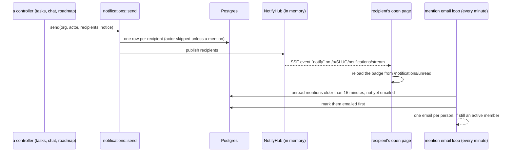

# Notifications

Each person has a bell. A notification is a row in `notifications` for one
recipient in one organisation. Open pages learn about new ones over
server-sent events (SSE). Mentions left unread for 15 minutes are emailed.

## How one is delivered

Rules:

- `send` saves first, then tells the hub (`src/controllers/notifications.rs:61`).
- Each recipient gets a row once per call. The actor is skipped, except for
  mentions (`src/models/notifications.rs:126`).
- Callers pass only ids from the organisation's active team.
- The SSE stream sends only the event name `notify` with data `1`. The page
  then fetches the count. Keep-alive every 25 seconds
  (`src/controllers/notifications.rs:546`).
- The stream follows one organisation, the one in its address
  (`/o/{slug}/notifications/stream`). Each tab has its own, so each tab's
  bell counts its own org. A notice in another of the person's orgs doesn't
  ping it; the badge polls every 60 seconds as a fallback.
- After subscribing, the stream checks the session version and the active
  membership again (the membership part is skipped for an acting super
  admin), so a close published meanwhile is never missed.
- The stream ends when the person is signed out everywhere, a password reset
  or a lock (every org), when they are removed from its org, or when it
  falls behind. Nothing ends it on a switch. The browser reconnects through
  `CurrentMember` again. A refused reconnect ends it for good, and `app.ts`
  then asks `/o/{slug}/orgs/current` once, so the tab moves. A bare
  `/notifications/stream` is refused (303), never a stream.
- `NotifyHub` is in memory, like `ChatHub`. The app must run as one instance.

## The bell

All under `/o/{slug}/`.

| Route | What it does |
|---|---|
| `GET /notifications` | The latest 50, newest first |
| `GET /notifications/unread` | The badge HTML: a count, "99+", or nothing |
| `GET /notifications/stream` | The SSE stream |
| `POST /notifications/<id>/open` | Marks one read, then follows its link inside this org (`member.url`; anything that isn't a path inside the org goes to `/dashboard`) |
| `POST /notifications/read` | Marks all read |

Everything is scoped to the viewer's organisation and user id. Another
person's notification id is "not found". `notifications.link` stays a path
inside its organisation (`/tasks?open=58`); the bell adds the prefix when
it opens one. Email links are unchanged until PR 2.

## What triggers each kind

`notifications.kind` values are in `src/models/notifications.rs:11`.

| Kind | Trigger | Recipients | Code |
|---|---|---|---|
| `assigned` | Task created or changed | People newly added as assignees | `task_saved`, `notifications.rs:97` |
| `project` | Task added to a project, or a task becomes `blocked` | The project's owner, if not already told | `task_saved` |
| `owner` | Project created or edited with a new owner | The new owner | `project_saved`, `:238` |
| `note` | Task note posted | The task's assignees not already told | `note_added`, `:168` |
| `mention` | `@name` or `@everyone` in a task note | Named teammates (author included); for `@everyone`, the whole team | `note_added` |
| `mention` | `@name` or `@everyone` in a chat message | Named people in the conversation; for `@everyone`, the conversation's other members | `message_sent`, `:269` |
| `mention` | `@name` or `@everyone` in a thread reply | As for chat, "in a thread" | `reply_sent`, `:338` |
| `reply` | Thread reply | The parent's author, then earlier repliers | `reply_sent` |

Who does not get a notification:

- Join requests, declines, removals and role changes send none.
- Approvals send no notification. They email the person instead ("Your
  join request was approved", `src/mailers/membership.rs`). Each email is
  recorded as an `auth_attempts` row of kind `approval_email` (the
  recipient's email hash, and `org:{id}` in `ip`) and counted: at most 20
  per organisation and 3 per recipient in any 24 hours. Approving,
  removing and approving the same person again counts every email.
- Reactions on messages and notes send none.
- `@everyone` from Claude, or from a super admin acting in another
  organisation, is ignored in task notes (`notifications.rs:192`).

## Mention emails

- An initializer starts a loop at boot that runs every 60 seconds, except in
  tests (`src/initializers/mention_emails.rs`).
- It picks `mention` notifications that are unread, not yet emailed and at
  least 15 minutes old (`src/mailers/mentions.rs:65`).
- It marks them emailed before sending, so a crash or restart never sends one
  twice. A failed email is logged and skipped.
- It sends one email per person per organisation, listing their mentions.
  People who are no longer active members are skipped.
- Removing a member marks all their pending emails as handled
  (`stop_emails`).
- The `emailed_at` migration marked every existing notification as emailed, so
  nothing old went out on deploy.

Only mentions are emailed. Other kinds stay in the bell.

Files: `src/controllers/notifications.rs`, `src/models/notifications.rs`,
`src/data/notify_hub.rs`, `src/mailers/mentions.rs`,
`src/initializers/mention_emails.rs`.
