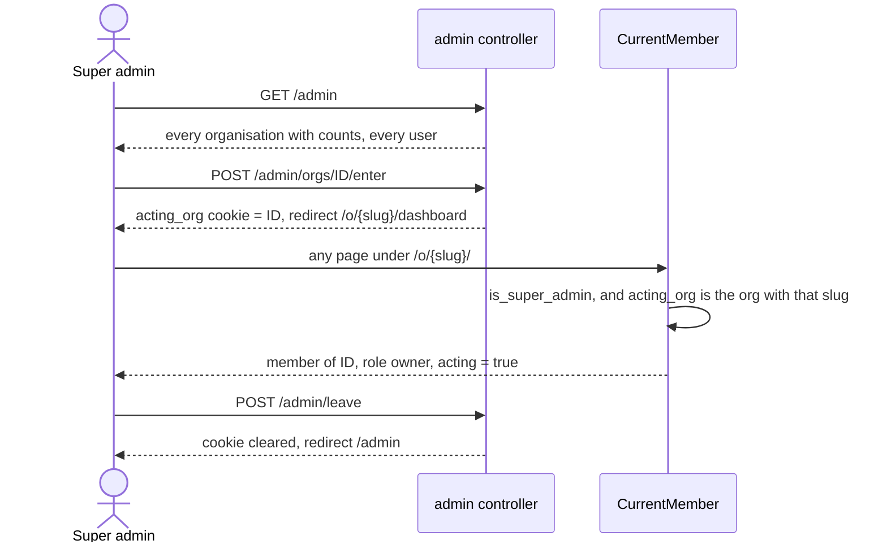

# Super admin and acting in another organisation

The platform super admin is a user with `users.is_super_admin = true`. They
see every organisation at `/admin` and can work inside any of them as an
owner. Working inside an organisation they do not belong to is called
"acting".

## Making the super admin

There is no sign-up path. Run the task:

```sh
SUPER_ADMIN_PASSWORD=choose-one cargo loco task super_admin
```

- It reads `settings.super_admin` (email, username, organisation name; set by
  `SUPER_ADMIN_*` variables in production, see `docs/deploy.md`).
- If the user does not exist, it needs `SUPER_ADMIN_PASSWORD` and creates
  them. If they exist, it never changes their password.
- It sets `is_super_admin` and, if they have no membership, creates their own
  organisation with them as owner.
- Safe to run again.

File: `src/tasks/super_admin.rs`.

## Entering and leaving an organisation



Rules:

- `/admin` and its routes answer 404 to anyone else, so the area is not
  advertised (`src/controllers/admin.rs:14`).
- Entering writes an info log line, "super admin entered organisation"
  (`src/controllers/admin.rs:73`). Nothing is written to the database.
- The `acting_org` cookie is `HttpOnly`, `SameSite=Lax`, and `Secure` in
  production. `CurrentMember` reads it only for super admins, so the cookie
  does nothing for anyone else (`src/extractors/session.rs:54`).
- While acting, the admin's own membership is ignored. Their username in that
  organisation is their `users.name`.
- Signing out (`POST /logout`) clears the cookie too.
- Signing in also clears it, so a new sign-in ends acting. `acting_org` has
  no `Max-Age`, so it already ended when the browser closed.
- Acting is per address. It applies only to `/o/{acting slug}/...`, where it
  wins over any membership of their own there. Their own organisations work
  normally in other tabs, and the acting banner shows only on the acting
  org's pages. The address never starts acting: `/o/x/...` without
  `acting_org` for X is the plain not-found page, the same as a made-up slug.
- Acting is never remembered in `current_org`. For bare addresses
  `acting_org` still comes first, then `current_org`, then the default.
- After `POST /admin/leave`, an open tab for the acting org gets the plain
  not-found on its next page load, and its HTMX calls the 409 to
  `/dashboard`.
- The old switch (`POST /orgs/{id}/switch`, kept for one release) clears
  `acting_org`. A super admin can only switch to orgs they belong to.
  Entering any other org stays on `/admin/orgs/{id}/enter`.
- A super admin with no active membership and no acting cookie is sent to
  `/admin`, even if they have a waiting request somewhere. A stray
  `current_org` is cleared on the way.
- A super admin can ask to join an organisation from their own account (see
  [accounts.md](accounts.md), "Join by link"). The join page says "This
  request comes from your own account" and "Asking ends acting", and asking
  clears `acting_org`. An acting super admin approves other people's
  requests as an owner would, but never their own: the approval's update
  refuses a row whose user is the approver.
- The stale-tab check compares the claim with the address's org (see
  [accounts.md](accounts.md), "Stale tabs"), the acting org on its pages.
- The switcher shows while acting only if they have a membership of their
  own. It reads "Acting in" with the acting org, ticked, as "Platform admin",
  then "Your organisations", each a link to that org. Acting carries on in
  the acting org's tabs. Leave stays in the banner. With no membership of
  their own the name is plain text.
- There is no "New organisation" row while acting, in the menu, the sheet or
  More: that menu is about where they are acting and the way back. A typed
  `/o/{slug}/orgs/new` still works. The form first says "You're acting in Acme
  Studio. Creating this ends acting. The new organisation is yours, with you
  as owner." Creating clears `acting_org`, makes the admin the owner of the
  new org, and copies nothing from the acting org: it keeps `Europe/London`.
  The log line names the acting org as `acting_org`.

The decision happens in `resolve_org` (`src/extractors/current_member.rs`):
`in_address_org` for `/o/{slug}/`, `last_org` for the bare addresses that
keep it. Both `CurrentMember` and `PinnedMember` run it.

## What acting allows and blocks

Acting gives the role `owner`, so owner and admin checks pass. Some actions
check `acting` and refuse.

| Area | While acting |
|---|---|
| Tasks, projects, roadmap, meetings, notes | Allowed |
| Approve or decline join requests, change roles, set the time zone | Allowed |
| Remove a member, see "Change these at the source" | Blocked (403) |
| Documents and logins, all routes | Blocked (403) |
| See a login password | Blocked (`can_reveal` is false) |
| React to a task note | Blocked (403) |
| `@everyone` in a task note | Saved, but notifies nobody; not offered in the @ menu |
| Connect Claude, make a personal token | Blocked: a page asks them to leave first |
| Chat | Only conversations they are a member of. They are not added to the organisation's `#general`. |

The blocks come from `CurrentMember::require_own_membership`
(`src/extractors/current_member.rs:133`) and direct `member.acting` checks in
`src/controllers/members.rs:48`, `src/controllers/tasks.rs:910`,
`src/controllers/notifications.rs:192`, `src/controllers/claude.rs:105`,
`src/controllers/oauth.rs:324` and `:363`, and `src/models/logins.rs:451`.

Unverified: chat routes have no `acting` check. Creating a group or starting
a DM while acting is not blocked in the code. Whether the UI offers it was not
checked.
