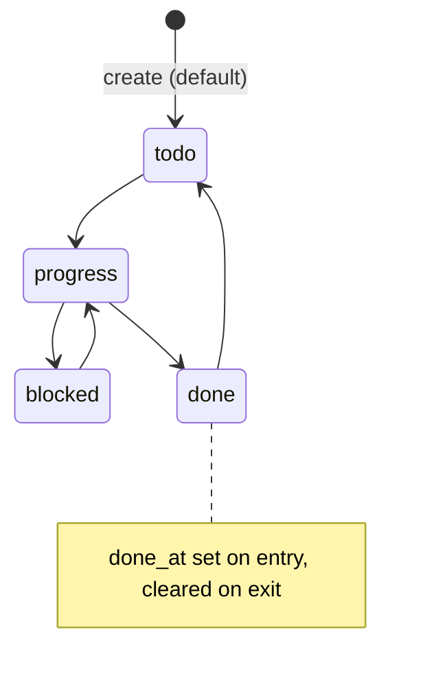
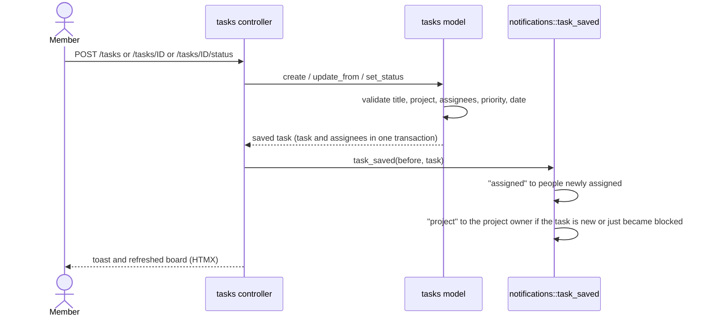
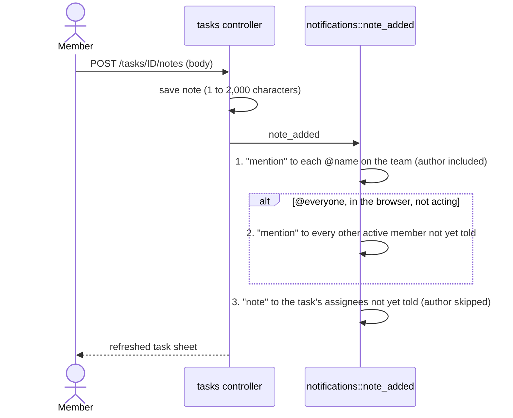

# Projects and tasks

Projects sit on the roadmap in lanes. Tasks sit on a board by status. A task
can belong to a project or be a chore with no project. Tasks have assignees
and notes, and notes can @mention people.

Every route here takes `CurrentMember`, so only active members of the
organisation (or a super admin acting inside it) can use them. There is no
role check: any member can create, edit and delete any task, and create or
edit any project.

Every app path below is under the organisation's address, `/o/{slug}/`
(so `POST /tasks` is `POST /o/acme-studio/tasks`). Bare paths redirect a page
load and refuse anything else (see [accounts.md](accounts.md), "Choosing an
organisation").

## Projects

- Created and edited on the roadmap: `POST /roadmap/projects` and
  `POST /roadmap/projects/<id>` (`src/controllers/roadmap.rs:202` and `:227`).
- Fields: name (1 to 80), lane (`now`, `next`, `later`), status (free text,
  1 to 40), accent (one of six colours), optional owner, summary (up to 500)
  (`src/models/projects.rs:46`).
- The owner must be an active member of the organisation.
- Progress is the share of the project's tasks that are `done`, rounded down
  (`src/models/projects.rs:11`). It is not stored.
- There is no route that deletes a project, in the web app or through Claude.

## Task lifecycle

Any status can move to any other; the diagram shows the usual path. The four
statuses are `todo`, `progress`, `blocked` and `done`
(`src/models/tasks.rs:12`). `done_at` is set and cleared in `before_save`, so
every route that changes status records it the same way.

## Create or change a task

Validation (`src/models/tasks.rs:54`):

- Title: 1 to 140 characters.
- Project: empty (a chore) or a project in this organisation.
- Assignees: each must be an active member. Duplicates are dropped.
- Priority: `high`, `medium` or `low`.
- Due date: empty or `YYYY-MM-DD`.
- Status: empty keeps the current one (or `todo` for a new task).

Rules:

- Assignees are a list (`task_assignees`). Saving replaces the list but keeps
  rows for people who stay (`src/models/task_assignees.rs:64`).
- Deleting a task (`POST /tasks/<id>/delete`) deletes its notes, assignees and
  note reactions through cascading keys. There is no bin.
- The board's Done column shows the latest 5 done tasks; the rest are in the
  Done view (`src/controllers/tasks.rs:36`).
- Board scopes are All and Mine. Swimlanes are by project, by person, or none.

Files: `src/controllers/tasks.rs:737` (create), `:796` (update), `:832`
(delete), `:1038` (status); `src/models/tasks.rs:154`, `:193`, `:228`.

## Notes, @mentions and @everyone

Rules (`src/controllers/notifications.rs:168`):

- A mention is `@` plus a username, not part of an email or a longer word.
  Matching ignores case. Only names on the team count; other `@words` stay
  plain text (`src/models/notifications.rs:29`).
- Each person gets one notice per note. A name wins over `@everyone`, and both
  win over the "commented on" notice.
- Tagging yourself notifies you. It works as a reminder. Every other kind
  skips the person who caused it (`src/models/notifications.rs:126`).
- `@everyone` in a task note only works for a person in the browser in their
  own organisation. Claude's tokens and a super admin acting elsewhere are
  ignored for `@everyone` (`src/controllers/notifications.rs:192`). The @ menu
  does not offer it to an acting super admin (`src/controllers/tasks.rs:910`).
- "everyone" is reserved: no username can be `everyone`.

## Note reactions

- `POST /tasks/<id>/notes/<note_id>/reactions` with `emoji` and `on` (`1` add,
  `0` remove). The client sends the state it wants, so a retry changes nothing.
- The six emoji are 👍 ❤️ 😂 🎉 👀 ✅ (`src/models/reactions.rs:14`).
- No notification and no live update.
- Needs a real membership: a super admin acting elsewhere gets 403
  (`src/controllers/tasks.rs:1117`).

## Notifications this flow sends

| Kind | When | Who |
|---|---|---|
| `assigned` | task created or changed | people newly added as assignees |
| `project` | task added to a project, or a task becomes `blocked` | the project's owner, unless already told |
| `owner` | project saved with a new owner | the new owner |
| `mention` | note names someone or says @everyone | see above |
| `note` | note posted | the task's assignees not already told |

The person who made the change is never sent `assigned`, `project`, `owner`
or `note`. See [notifications.md](notifications.md) for delivery.
